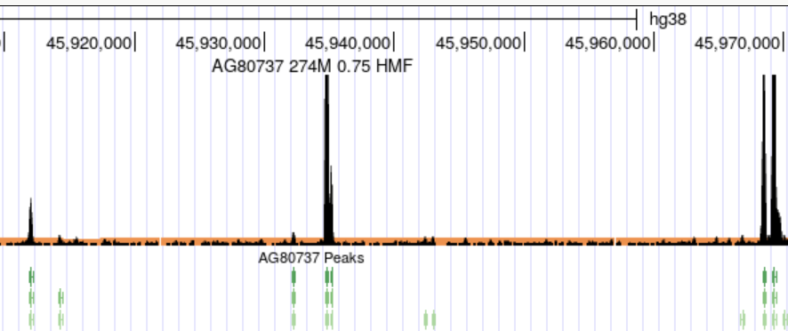

# hotspot3
hotspot3 is a peak caller for chromatin accessibility data. It is tailored to work on  datasets without a control experiment (ATAC-seq and DNase-seq) using adaptive estimation of the background (nonspecific cleavages) with a negative binomial distribution. hotspot3 accounts for variation in both total signal level and signal-to-background ratio along the genome.

The main algorithm steps are: 
- **Adaptive background modeling** using a negative binomial distribution, fitted within locally uniform genomic segments. 
- **Bayesian segmentation** (via [BABACHI](https://github.com/autosome-ru/BABACHI)) to partition the genome into regions with a homogeneous background (i.e., similar signal-to-noise ratio, modeled using a common overdispersion parameter in the background model).
- **Per-base statistical testing** to assign p-values and estimate FDR for enrichment at each position.  
- **Signal smoothing** using the Maximal Overlap Discrete Wavelet Transform (MODWT) to suppress local noise and normalize fine-scale variability (e.g., transcription factor footprints)
- **Hotspot calling**, which identifies contiguous regions of signal enrichment at a specified FDR threshold.  
- **Peak calling**, which detects peaks from the smoothed signal and reports those that overlap with significant bases.

hotspot3 is optimized for scalability on large datasets with chromosome-level parallelism and optional reuse of intermediate results. 

⚠️ hotspot3 has been primarily tested on the datasets with 10 million or more tags. Lower coverage may work, but the results could be less stable.

Coding agents: read [AGENTS.md](AGENTS.md) first.

## Table of contents

- [Command line interface](#command-line-interface)
- [Installation](#installation)
  - [Prerequisites](#prerequisites)
  - [1. Create conda environment](#1-create-conda-environment-from-environmentyml)
  - [2. Install hotspot3](#2-install-hotspot3)
  - [3. Test installation](#3-test-installation)
- [Usage example](#usage-example)
  - [Basic peak calling from BAM/CRAM](#basic-peak-calling-from-bamcram)
  - [Additional FDR thresholds (reuse intermediate files)](#additional-fdr-thresholds-reuse-of-precomputed-data)
  - [Running from Python](#running-from-python)
  - [Cut counts only](#cut-counts-only)
- [Input parameters](#input-parameters)
  - [Required arguments](#required-arguments)
  - [Arguments to skip steps using pre-calculated data](#arguments-to-skip-steps-using-pre-calculated-data)
  - [Optional arguments](#optional-arguments)
  - [Change if you know what you are doing](#change-if-you-know-what-you-are-doing)
  - [Additional parameters (Python only)](#additional-parameters-python-only)
- [Output files](#output-files)
  - [Main outputs](#main-outputs)
  - [Peak and hotspot calls (for each FDR threshold)](#peak-and-hotspot-calls-for-each-fdr-threshold)
  - [Debug folder](#debug-folder)
- [Interpreting output](#interpreting-output)
  - [Visualizing results in a genome browser](#visualizing-results-in-a-genome-browser)
  - [Flagging problematic segments](#flagging-problematic-segments)
    - [refit_with_constraint = True](#refit_with_constraint--true)
    - [success_fit = False](#success_fit--false)
    - [max_bg_reached = True](#max_bg_reached--true)
- [Performance and resource requirements](#performance-and-resource-requirements)
- [Authors](#authors)
  
# Command line interface
- `hotspot3` - Call peaks from input data using MODWT-smoothed signal and local background estimation.
- `hotspot3-cutcounts` - Extract per-base cut counts from a BAM/CRAM file (the first step of `hotspot3`), see [Cut counts only](#cut-counts-only).
- `hotspot3-track-mem` - (Development) Run `hotspot3` with the same arguments and log its memory usage to `{outdir}/{sample_id}.memory_usage.tsv`. Requires `pip install "hotspot3[dev]"`.
- `hotspot3-pvals` - (Experimental) Extract raw p-values for regions defined in a reference BED file. This is useful when comparing or aggregating signal across multiple samples at predefined loci (e.g., shared peak positions), enabling downstream consensus ("core") peak calling.
- `hotspot3-trackhub` - Write a single-file UCSC track hub to view a sample's results in the genome browser: normalized density with the background overlaid, hotspots and peaks at several FDRs. Each file is given explicitly (`--density_bw`, `--background_bw`, `--hotspots_bb FDR FILE`, `--peaks_bb FDR FILE`; local paths or URLs); the hub links the track description page in this repository ([trackhub_description.html](docs/trackhub_description.html)); example in [Visualizing results in a genome browser](#visualizing-results-in-a-genome-browser), all options in `hotspot3-trackhub --help`.
# Installation
## Prerequisites
`conda` (recommended: `mamba` for faster solves)
`python ≥ 3.8`
## 1. Create conda environment from environment.yml
### For linux:
```
mamba env create -n hotspot3 -f environment.yml
conda activate hotspot3
```
### For macOS:
```
mamba env create -n hotspot3 -f environment.macos.yml
conda activate hotspot3
```
The environment also provides the command line tools hotspot3 calls (`samtools`, `bedops`, `bedToBigBed`, `bgzip`), which `pip` doesn't install.
## 2. Install hotspot3
Once the environment is activated:
```
pip install hotspot3
```
Or to install in the developer mode:
```
git clone https://github.com/vierstralab/hotspot3.git
cd hotspot3
pip install -e .
```
## 3. Test installation
You can check that the CLI is working with:
```
hotspot3 --help
```
# Usage example 
## Basic peak calling from BAM/CRAM
```
hotspot3 AG10883 \
  --chrom_sizes https://resources.altius.org/~sabramov/files/hotspot3/GRCh38_no_alts.nuclear.chrom_sizes \
  --mappable_bases https://resources.altius.org/~sabramov/files/hotspot3/GRCh38_no_alts.K36.n150.center_sites_and_extended_blacklist.bed.gz \
  --bam AG10883.filtered.cram \
  --fdrs 0.01 0.05 0.1 \
  --outdir ./AG10883 \
  --save_density \
  --cpus 6
```
This command uses a CRAM file to call peaks at 1%, 5%, and 10% FDR, and save cutcount density. It uses 6 threads for parallel processing.

## Additional FDR thresholds (reuse of precomputed data)
Peaks at a stricter FDR than the highest one used in the run can be called from the saved per-base FDRs:
```
hotspot3 AG10883 \
  --chrom_sizes https://resources.altius.org/~sabramov/files/hotspot3/GRCh38_no_alts.nuclear.chrom_sizes \
  --mappable_bases https://resources.altius.org/~sabramov/files/hotspot3/GRCh38_no_alts.K36.n150.center_sites_and_extended_blacklist.bed.gz \
  --cutcounts ./AG10883/AG10883.cutcounts.bed.gz \
  --signal_parquet ./AG10883/debug/AG10883.smoothed_signal.parquet \
  --fdrs_parquet ./AG10883/debug/AG10883.fdrs.parquet \
  --fdrs 0.001 \
  --outdir ./AG10883 \
  --cpus 6
```
This reuses previously computed intermediate files to quickly generate peaks at an additional FDR threshold (e.g., 0.001). Runtime is ~30 seconds.

The per-base FDR file only stores values up to the highest FDR of the original run. For a more lenient threshold (e.g., 0.2), pass `--pvals_parquet ./AG10883/AG10883.pvals.parquet` instead of `--fdrs_parquet`: FDRs are then recalculated from the saved p-values, which takes longer but still skips the background fit.

## Running from Python
The command line interface is a thin wrapper around the following calls, which can be used directly in a script or a Jupyter notebook:
```python
from hotspot3.config import ProcessorConfig
from hotspot3.processors import GenomeProcessor
from hotspot3.io.paths import Hotspot3Paths
from hotspot3.from_configs import run_from_configs

genome_processor = GenomeProcessor(
    sample_id="AG10883",
    chrom_sizes_file="https://resources.altius.org/~sabramov/files/hotspot3/GRCh38_no_alts.nuclear.chrom_sizes",
    mappable_bases_file="https://resources.altius.org/~sabramov/files/hotspot3/GRCh38_no_alts.K36.n150.center_sites_and_extended_blacklist.bed.gz",
    config=ProcessorConfig(cpus=6),
)
paths = Hotspot3Paths(
    outdir="./AG10883",
    sample_id="AG10883",
    bam="AG10883.filtered.cram",
    save_density=True,
)
run_from_configs(genome_processor, paths, fdrs=[0.01, 0.05, 0.1])
```
- `Hotspot3Paths` accepts the same precomputed inputs as the command line: `cutcounts`, `smoothed_signal`, `pvals` and `fdrs`.
- `ProcessorConfig` holds all model parameters (see `src/hotspot3/config.py`).
- With `cpus > 1` chromosomes are processed in separate processes.

## Cut counts only
```
hotspot3-cutcounts AG10883 \
  --chrom_sizes https://resources.altius.org/~sabramov/files/hotspot3/GRCh38_no_alts.nuclear.chrom_sizes \
  --bam AG10883.filtered.cram \
  --outdir ./AG10883 \
  --cpus 6
```
This writes `{sample_id}.cutcounts.bed.gz` and `{sample_id}.total_cutcounts` (see [Main outputs](#main-outputs)) and stops. Peak calling can be continued later by passing the file to `hotspot3` with `--cutcounts`.

To get cut counts as a bigWig instead, [figwig](https://figwig.readthedocs.io) counts 5′ ends of reads without filtering or shifting as well: `figwig bam2bw AG10883.filtered.bam -s GRCh38_no_alts.nuclear.chrom_sizes -n AG10883 -u` (Python ≥ 3.10).

# Input parameters
## Required arguments
- `sample_id` - Unique identifier for the sample (used for naming outputs).
- `--chrom_sizes CHROM_SIZES` - Two-column TSV file with chromosome names and sizes (no header). Local path or URL. For GRCh38 you can use [GRCh38_no_alts.nuclear.chrom_sizes](https://resources.altius.org/~sabramov/files/hotspot3/GRCh38_no_alts.nuclear.chrom_sizes).
    + Chromosome names must match those in the BAM/CRAM and reference FASTA.
    + The order of chromosomes in this file determines the order in BED, BigWig and BigBed outputs.
    + Use UCSC-style naming (e.g., `chr1`, `chr2`, ..., `chrX`, `chrY`) and exclude alternate contigs unless needed.

- `--bam BAM` - Path to the input BAM or CRAM file (indexed).
    + Each read contributes one cut at its 5′ end (strand-aware); for paired-end data both mates are counted.
    + Reads are used as is: filter the file beforehand (e.g., by mapping quality, duplicates, unpaired or improperly paired reads).
    + No Tn5 shift is applied to ATAC-seq reads.

## Arguments to skip steps using pre-calculated data

- `--cutcounts CUTCOUNTS` - Tabix-indexed file with per-base cut counts. Skips extracting cut counts from BAM/CRAM.
- `--signal_parquet SIGNAL_PARQUET` - Path to pre-calculated partitioned parquet file(s) with per-bp smoothed signal. Skips MODWT signal smoothing
- `--pvals_parquet PVALS_PARQUET` - Path to pre-calculated partitioned parquet file(s) with per-bp p-values. Skips p-value calculation
- `--fdrs_parquet FDRS_PARQUET` - Path to pre-calculated partitioned parquet file(s) with per-bp FDRs. Skips FDR calculation

## Optional arguments
- `--fdrs FDRS [FDRS ...]` - Space separated list of FDR thresholds to generate peak calls and hotspots at (default: 0.05).

⚠️ **Note**: The resulting per-base FDR file will only include values **up to the highest FDR** you specify.  
All higher FDR values will be `NaN`, so you won’t be able to call peaks at higher thresholds later  
without re-running the FDR step from raw p-values (see [Additional FDR thresholds](#additional-fdr-thresholds-reuse-of-precomputed-data)).

- `--cpus CPUS` - Number of CPUs to use. A high thread count increases memory usage — no benefit from using more CPUs than the number of chromosomes.
  
- `--reference REFERENCE` - Path to reference FASTA (required for CRAMs missing sequence dictionary).
- `--mappable_bases MAPPABLE_BASES` - Three column (chrom, start, end) tabix-indexed BED file listing mappable positions. Local path or URL.
    + Reads can't be uniquely aligned to repetitive regions, so a low cut count there doesn't mean low accessibility. Unmappable positions are excluded from the background model fit and are not tested.
    + Without this file all positions are treated as mappable.
    + For GRCh38 you can use positions uniquely mappable with 36 bp reads (K36), with [ENCODE blacklist regions](https://github.com/Boyle-Lab/Blacklist/tree/master/lists) excluded: [GRCh38_no_alts.K36.n150.center_sites_and_extended_blacklist.bed.gz](https://resources.altius.org/~sabramov/files/hotspot3/GRCh38_no_alts.K36.n150.center_sites_and_extended_blacklist.bed.gz)
    + Coordinates must fit within `--chrom_sizes` (hotspot3 stops with an error otherwise). Chromosomes missing from the file are skipped, so check that chromosome names match.

- `--chromosomes CHROMOSOMES [CHROMOSOMES ...]` - Restrict to specific chromosomes (for debugging).
- `--save_density` -  Save normalized cut count density as output.

- `--debug` - Enable debug mode (extra logging).
- `--outdir OUTDIR` - Path to output directory
- `--tempdir TEMPDIR` - Path to temp directory. Defaults to the system temp location.

## Change if you know what you are doing
- `--window WINDOW` - Smoothing window size for cut counts.
- `--background_window BACKGROUND_WINDOW` - Background window size
- `--signal_quantile SIGNAL_QUANTILE` - Fraction of genomic positions to model as a background (default: 0.995). Used to exclude extreme outliers (e.g., regions with unusually high coverage) when fitting the background model. This reduces computational burden by limiting the background estimation to the lower portion of the signal distribution (e.g., the lowest 99.5% of sites if `--signal_quantile 0.995`).

## Additional parameters (Python only)
Other parameters can be set through `ProcessorConfig` when [running from Python](#running-from-python), e.g. `ProcessorConfig(cpus=6, min_peak_half_width=20)`. All of them are listed in `src/hotspot3/config.py`; the ones most likely to be useful (default in brackets):
- `min_signif_bases_for_peak` (10) - Minimal number of significant bases around a peak summit (within `--window`). Lower it to call peaks in very narrow significant regions.
- `min_peak_half_width` (10) - Minimal distance (bp) from the summit to each peak boundary, i.e. sets the minimal peak width (2 × 10 + 1 = 21 bp by default).
- `fdr_method` ('bh') - FDR correction method: 'bh' (Benjamini-Hochberg) or 'by' (Benjamini-Yekutieli, more conservative). Only 'bh' is extensively tested.
- `min_mappable_bases_proportion` (0.05) - Minimal fraction of mappable bases within the window for a position to be tested.
- `outlier_segment_threshold` (5) - Segments with a signal-to-noise ratio above this many times the genome-wide fit are refit with a constraint (see [refit_with_constraint](#refit_with_constraint--true)).
- `density_track_step` (20) - Resolution (bp) of `{sample_id}.normalized_density.bw`.

`--window`, `--background_window` and `--signal_quantile` correspond to `window`, `bg_window` and `max_background_prop`.


# Output files

hotspot3 produces several output files, including signal tracks, peak calls, and internal model diagnostics. Most files are saved in the output directory, while large intermediate files are placed in the `debug/` folder for optional inspection or reuse.

---

## Main outputs

- `{sample_id}.cutcounts.bed.gz` — Tabix-indexed file with per-base cut counts (~200MB). Columns `#chr`, `start`, `end`, `count`: one row per position with at least one cut (5′ end of a read), positions without cuts are omitted. Can be created alone with `hotspot3-cutcounts`.
- `{sample_id}.total_cutcounts` — Total number of cut counts observed in the sample (~10KB)

- `{sample_id}.fit_stats.bed.gz` — Tabix-indexed BED file with background model fit statistics for each segment (~20MB)

- `{sample_id}.pvals.parquet` — Per-base raw p-values (~1.5GB). Can be used later to aggregate p-values across datasets.

- `{sample_id}.normalized_density.bw` — Normalized raw signal (**cuts per million**), generated if `--save_density` is specified (~200MB). Useful for visualization.

- `{sample_id}.background.bw` — Final estimated background level at each position, based on the local negative binomial model (corresponding to the `p = 0.005` cutoff). Useful for visualization and model inspection.
  
---

## Peak and hotspot calls (for each FDR threshold)

- `fdr{fdr}/{sample_id}.hotspots.fdr{fdr}.bed.gz` — Tabix-indexed file with called hotspots
- `fdr{fdr}/{sample_id}.hotspots.fdr{fdr}.bb` — Hotspots in BigBed (BED12) format

- `fdr{fdr}/{sample_id}.peaks.fdr{fdr}.bed.gz` — Tabix-indexed file with called peaks
- `fdr{fdr}/{sample_id}.peaks.fdr{fdr}.bb` — Peaks in BigBed (BED12) format

**Hotspots** are contiguous regions of bases significant at the given FDR. **Peaks** are local maxima of the smoothed signal within these regions, trimmed to the width of the peak; a hotspot can contain several peaks. For most downstream analyses (e.g., merging samples into a consensus set) use peaks.

Both `.bed.gz` files have a header line. Coordinates are 0-based, half-open (BED); signal values are in cuts per million.

Hotspots:
- `#chr`, `start`, `end` — hotspot coordinates
- `id` — sample ID
- `max_neglog10_fdr` — maximal -log10(FDR) within the hotspot

Peaks:
- `#chr`, `start`, `end` — peak coordinates
- `id` — sample ID
- `max_density` — maximal normalized density within the peak
- `summit_density` — normalized density at the summit
- `summit` — summit position (maximum of the smoothed signal)
- `smoothed_peak_height` — smoothed signal level at which the peak boundaries are set: half of the smoothed summit height, or the higher of the two flanking minima if it is larger

---

## Debug folder

The following large intermediate files are always saved to the `debug/` subdirectory of the output path. These can be reused for re-calling peaks at additional FDR thresholds or inspected to understand model behavior.

- `{sample_id}.smoothed_signal.parquet` — Per-base MODWT-smoothed signal (~2GB)
- `{sample_id}.fdrs.parquet` — Per-base FDR values, stored up to the highest FDR used in the run (~600MB)
- `{sample_id}.fit_params.parquet` — Per-base final model parameters (~2GB)
- `{sample_id}.thresholds.bw` — Per-base signal threshold used to select background bases during model fitting
- `{sample_id}.per_segment.background.bw` — Segment-level background estimate (signal threshold corresponding to the `p = 0.005` cutoff under the fitted model)

---

 `hotspot3` does **not** automatically delete the `debug/` folder upon completion. It takes several GB per sample, so if you don't plan to call peaks at additional FDR thresholds or inspect the model fit, we recommend deleting it after the run.


# Interpreting output
Once hotspot3 has finished running, the most effective way to understand and validate the results is by visualizing key tracks and inspecting background fits.

## Visualizing results in a genome browser
You can load the following files in IGV or the UCSC Genome Browser for interactive inspection:


- `{sample_id}.normalized_density.bw` — **(black track)** BigWig file with normalized cut count density (in cuts per million).  
- `{sample_id}.background.bw` — **(orange track)** BigWig file representing the estimated background level at each position (defined by raw p-value > 0.005).  
  Overlay with the normalized density to visualize how much observed signal exceeds the modeled background.

- `{sample_id}.hotspots.fdr{fdr}.bb` - called hotspots at each FDR threshold
- `{sample_id}.peaks.fdr{fdr}.bb` - **(green track)** Called peaks at each FDR threshold.

To load all of them at once, write a UCSC track hub with `hotspot3-trackhub`, e.g. for a sample on [regulome](https://regulome.altius.org):
```bash
hotspot3-trackhub --name AG95384 \
    --density_bw https://regulome.altius.org/data/per_sample/AG95384/AG95384.normalized_density.bw \
    --background_bw https://regulome.altius.org/data/per_sample/AG95384/peaks/AG95384.background.bw \
    --hotspots_bb 0.001 https://regulome.altius.org/data/per_sample/AG95384/peaks/fdr0.001/AG95384.hotspots.fdr0.001.bb \
    --hotspots_bb 0.01 https://regulome.altius.org/data/per_sample/AG95384/peaks/fdr0.01/AG95384.hotspots.fdr0.01.bb \
    --hotspots_bb 0.05 https://regulome.altius.org/data/per_sample/AG95384/peaks/fdr0.05/AG95384.hotspots.fdr0.05.bb \
    --peaks_bb 0.001 https://regulome.altius.org/data/per_sample/AG95384/peaks/fdr0.001/AG95384.peaks.fdr0.001.bb \
    --peaks_bb 0.01 https://regulome.altius.org/data/per_sample/AG95384/peaks/fdr0.01/AG95384.peaks.fdr0.01.bb \
    --peaks_bb 0.05 https://regulome.altius.org/data/per_sample/AG95384/peaks/fdr0.05/AG95384.peaks.fdr0.05.bb \
    --out AG95384.hub.txt
```
The hub is a single file. Put it on any public web server and paste its URL into the UCSC browser (My Data > Track Hubs), or pass that URL as `--hub_url` to print a link that opens the hub. Files can also be local paths.


## Flagging problematic segments

The file `{sample_id}.fit_stats.bed.gz` contains background model parameters for each genomic segment identified by `hotspot3`. This file helps diagnose modeling issues that may affect the peak calling.

Each row includes:

- **Coordinates**: `#chr`, `start`, `end`
- **Negative binomial parameters**: `r`, `p`
- **Background and total cut counts**: Total number of tags in the region and how many are used to produce the best background fit
- **Segment SPOT score**: Signal Proportion Of Tags. Proportion of tags that were not used to fit the background model (i.e., signal tags)
- **Overall SPOT score**: Weighted median of segment SPOT scores — a dataset-level quality metric
- **Status flags**: `refit_with_constraint`, `success_fit`, `max_bg_reached`

---

### ⚠️ What to look for

#### `refit_with_constraint = True`
- The segment was initially assigned too much signal (i.e., too high SPOT score).
- It was re-fit using a **minimum background proportion constraint** to prevent overcalling peaks.
- This commonly occurs in regions where the signal distribution deviates from the negative binomial assumption, such as **telomeres** or **centromeres**.
- **This is not a failure**, but a safeguard to ensure model robustness.

In these cases, `hotspot3` applies a conservative re-fit to enforce a **maximum signal-to-noise ratio** — by default, no more than 5x the global weighted median.  
Outlier segments are identified using a robust linear fit (`RANSACRegressor`) signal-to-noise ratio vs segment length, and then re-fit to avoid inflating background estimates.


#### `success_fit = False`
- The model failed to fit a negative binomial distribution for this segment (even when using all the data).
- This happens in regions with very low signal.
- ❗**Peaks will not be called** in these segments.

If many segments are flagged this way, it may indicate insufficient coverage for reliable modeling — consider increasing sequencing depth or focusing on higher-quality regions.


#### `max_bg_reached = True`
- Even after assigning **99.5% of positions** as background, the remaining 0.5% still contained more signal than allowed.
- This means the segment exceeded the [maximum signal-to-noise ratio threshold](#refit_with_constraint--true) and could not be re-fit under constraints.

This usually indicates:

- ⚠️ **Mapping artifacts** (e.g., multimappers, misalignments)
- ⚠️ **Collapsed repeats or copy number variants**
- ⚠️ **Biological outliers** (e.g., viral integrations)

Segments with this flag **may still produce peaks**, but the background is likely overestimated, which can reduce sensitivity.  
This flag is rare, typically occurring in a small number of samples (e.g., ~100 out of 16,000 analyzed datasets).

---

**Tip:** If many segments are flagged with `max_bg_reached = True`, consider:
- inspecting affected regions visually,
- excluding problematic chromosomes or regions from analysis.
- increasing `--signal_quantile` (e.g., from 0.995 to 0.998)


# Performance and resource requirements
- **Typical runtime**: ~1 hour for a 100 million read CRAM file.
  
- **Runtime is largely independent of dataset coverage**, since most computations are per-base rather than per-read.
  
- **Recommended input coverage**: At least 10 million mapped reads for a somewhat reliable background fit.
  
- **CPU usage**: Parallelized by chromosome. Using more CPUs (e.g., 24 for all chromosomes) reduces wall-clock time but significantly increases memory usage.

- **Memory usage**: ~80 GB RAM with 6 CPUs. Can exceed 150 GB when using 24 threads (e.g., one per chromosome).

- **Recommendation**: Use a machine with 100–200 GB RAM for high-threaded runs (significantly improves time). Reduce thread count to lower memory use.

# Authors

Developed by:

- Sergey Abramov
- Alexandr Boytsov
- Jeff Vierstra

Altius Institute for Biomedical Sciences
